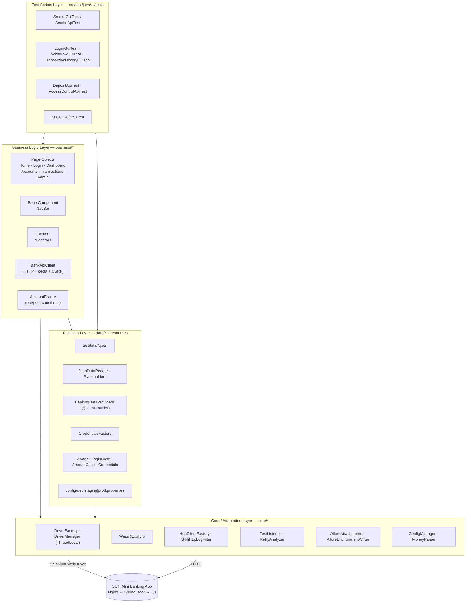

# MBA TAF — фреймворк автоматизації тестування Mini Banking App

Лабораторна робота №5 «Test Automation Architecture & Design Patterns».
Об'єкт тестування (SUT) — вебзастосунок онлайн-банкінгу з бакалаврської дипломної роботи
(Spring Boot 3, Spring Security, Thymeleaf, Azure SQL; розгортання на Azure VM за Nginx та Application Gateway + WAF).

Стек TAF: Java 17 · Maven · TestNG · Selenium 4 · REST Assured · Jackson · jsoup · AssertJ · Allure · SLF4J/Logback · GitHub Actions.

Марії Коротун ІПЗм-26-1

---

## 1. Архітектура (gTAA)



| Шар | Відповідальність | Реалізація |
|---|---|---|
| **Test Scripts** | Сценарії, анотації TestNG, assertions | `tests/*`: лише кроки бізнес-сценарію та перевірки, без локаторів і HTTP-деталей |
| **Business Logic** | Page Objects, API-клієнт, бізнес-кроки | `business/pages`, `business/components`, `business/locators`, `business/api`, `business/fixtures` |
| **Core / Adaptation** | Драйвери, очікування, HTTP, логування, звіти, утиліти | `core/driver`, `core/wait`, `core/http`, `core/listeners`, `core/report`, `core/config`, `core/util` |
| **Test Data** | Конфіги, файли даних, фабрики сутностей | `data/*`, `resources/testdata/*.json`, `resources/config/*.properties` |

Залежності йдуть лише «згори вниз»: тести не звертаються до WebDriver напряму, Page Objects не знають про TestNG,
шар даних не знає про сторінки. Тому зміна верстки зачіпає лише клас локаторів, а заміна Selenium
на інший інструмент — лише Core-шар.

### Структура каталогів

```
mba-taf/
├── .github/workflows/taf.yml          # CI/CD: теги, паралелізація, середовища, Allure
├── Dockerfile                          # запуск TAF у будь-якому CI
├── pom.xml
└── src/
    ├── main/java/com/mba/taf/
    │   ├── core/                       # ── Core / Adaptation Layer
    │   │   ├── config/ConfigManager
    │   │   ├── driver/DriverFactory, DriverManager
    │   │   ├── wait/Waits
    │   │   ├── http/HttpClientFactory, Slf4jHttpLogFilter
    │   │   ├── listeners/TestListener, RetryAnalyzer, RetryTransformer
    │   │   ├── report/AllureAttachments, AllureEnvironmentWriter
    │   │   └── util/MoneyParser
    │   ├── business/                   # ── Business Logic Layer
    │   │   ├── locators/*Locators      # локатори окремо від методів взаємодії
    │   │   ├── pages/BasePage, HomePage, LoginPage, DashboardPage,
    │   │   │         AccountsPage, TransactionsPage, AdminPage
    │   │   ├── components/NavBar
    │   │   ├── api/BankApiClient, AccountView, OperationResult
    │   │   └── fixtures/AccountFixture
    │   └── data/                       # ── Test Data Layer
    │       ├── model/  reader/  provider/  factory/
    ├── main/resources/
    │   ├── config/dev.properties, staging.properties, prod.properties
    │   └── logback.xml
    └── test/
        ├── java/com/mba/taf/tests/     # ── Test Scripts Layer
        │   ├── base/  smoke/  gui/  api/  defects/
        └── resources/
            ├── testdata/login.json, deposit.json, withdraw.json
            ├── allure/categories.json
            └── testng.xml
```

---

## 2. Page Object Model

**Таблиця 2.1 — Реєстр класів Page Object / компонентів**

| Клас | Сторінка (URL) | Клас локаторів | Основні бізнес-методи |
|---|---|---|---|
| `BasePage` | — (абстрактний) | — | `click`, `type`, `text`, `isDisplayed`, `isOpened`, `openPath` |
| `HomePage` | `/` | `HomeLocators` | `open`, `heroTitle`, `featureCount`, `goToLogin` |
| `LoginPage` | `/login` | `LoginLocators` | `open`, `loginAs`, `loginExpectingError`, `isSubmitBlockedByBrowser`, `errorMessage` |
| `DashboardPage` | `/dashboard` | `DashboardLocators` | `open`, `greetingUsername`, `ownAccountCount`, `isAdminToolsVisible`, `navBar` |
| `AccountsPage` | `/accounts` | `AccountsLocators` | `open`, `balanceOf`, `deposit`, `withdraw`, `isAmountAcceptedByBrowser`, `successMessage`, `errorMessage` |
| `TransactionsPage` | `/transactions` | `TransactionsLocators` | `open`, `rowsForAccount` → `List<TransactionRow>` |
| `AdminPage` | `/admin` | `AdminLocators` | `open`, `hasUser`, `roleOf`, `isActive`, `userCount` |
| `NavBar` (компонент) | спільна панель | `NavBarLocators` | `goToAccounts`, `goToTransactions`, `goToDashboard`, `goToAdmin`, `isAdminLinkVisible`, `logout` |
| `BankApiClient` (API) | HTTP | — | `login`, `accounts`, `deposit`, `withdraw`, `findUserId`, `createAccount`, `deleteAccount` |

Принципи:
- **Інкапсуляція.** Тест викликає `accounts.withdraw(id, "100.00")` і не знає ні локаторів, ні того, що після POST відбувається редирект.
- **Fluent-навігація.** Методи переходу повертають наступну сторінку: `new LoginPage(d).open().loginAs(u, p).navBar().goToAccounts()`.
- **Розширюваність.** Нова сторінка = клас локаторів + клас, що успадковує `BasePage`. Спільна навігація винесена в `NavBar` і не дублюється.
- **Динамічні локатори** (`AccountsLocators.cardById(id)`, `TransactionsLocators.rowsForAccount(id)`) знаходять картку чи рядок конкретного тестового рахунку.

---

## 3. Data-Driven Testing

Дані винесені з коду в JSON (`src/test/resources/testdata`). Кожен файл містить три категорії наборів:

| Файл | Тест | VALID | BOUNDARY | INVALID |
|---|---|---|---|---|
| `login.json` | `LoginGuiTest` | 2 | 2 | 3 |
| `deposit.json` | `DepositApiTest` | 2 | 3 | 3 |
| `withdraw.json` | `WithdrawGuiTest` | 2 | 3 | 3 |

Приклад (`deposit.json`):

```json
{
  "description": "Поповнення рахунку (через HTTP, перевірка серверної валідації). Початковий баланс 0.00",
  "cases": [
    { "id": "D-03", "category": "BOUNDARY", "initialBalance": "0.00", "amount": "0.01",
      "expected": "SUCCESS", "expectedBalance": "0.01",
      "expectedMessage": "Рахунок успішно поповнено!", "description": "Мінімальна допустима сума" },
    { "id": "D-07", "category": "INVALID", "initialBalance": "0.00", "amount": "abc",
      "expected": "BAD_REQUEST", "expectedBalance": "0.00",
      "expectedMessage": null, "description": "Нечислове значення" }
  ]
}
```

Ланцюжок: `JSON → JsonDataReader (Jackson → record) → BankingDataProviders (@DataProvider) → @Test(dataProvider=...)`.

- Паролі не зберігаються в даних: `"password": "${user.password}"` підставляється з конфігурації середовища (`Placeholders`).
- Фільтр категорій без зміни коду: `-Ddata.categories=BOUNDARY,INVALID`.
- Новий кейс додається одним об'єктом у JSON, код тестів не змінюється.

---

## 4. Автотести

**Таблиця 4.1 — Реєстр автотестів** (стовпець «Статус» заповнити за результатами запуску)

| ID | Сценарій | Тип | Набір даних | Групи | Статус |
|---|---|---|---|---|---|
| TC-01 | Публічна сторінка відкривається і веде на форму входу | GUI | — | smoke | |
| TC-02 | Сторінка входу доступна, містить CSRF-токен | API | — | smoke | |
| TC-03 | Анонім не має доступу до кабінету (302 → /login) | API | — | smoke, security | |
| TC-04 | Вхід у систему | GUI, DDT | `login.json` (7) | regression | |
| TC-05 | Поповнення: серверна валідація суми | API, DDT | `deposit.json` (8) | regression | |
| TC-06 | Зняття коштів через UI | GUI, DDT | `withdraw.json` (8) | regression | |
| TC-07 | E2E: операції відображаються в історії транзакцій | GUI | — | regression, e2e | |
| TC-08 | ROLE_USER отримує 403 на /admin | API | — | security | |
| TC-09 | ROLE_ADMIN має доступ до /admin | API | — | security | |
| TC-10 | Невдалий вхід не створює сесію | API | — | security | |
| DEF-01..03 | Відомі дефекти (див. розділ 7) | API | — | known-defect | очікувано Failed |

Разом 10 тестових методів, а з урахуванням параметризації 30 запусків у regression.

Фікстури:
- `@BeforeMethod`: окремий браузер на тест (`BaseGuiTest`); **новий рахунок** з потрібним початковим балансом, створений через HTTP (`AccountFixture`). Тести ізольовані один від одного і від порядку запуску.
- `@AfterMethod(alwaysRun = true)`: закриття браузера, видалення тестового рахунку навіть після падіння тесту.

---

## 5. Логування, звіти, Failure Recovery

| Механізм | Де реалізовано |
|---|---|
| Скриншот + HTML сторінки + URL при падінні GUI-тесту | `TestListener.afterInvocation` → `AllureAttachments` (до `@AfterMethod`, поки браузер відкритий) |
| Логи HTTP-запитів і відповідей | `Slf4jHttpLogFilter` (лог, паролі й CSRF замасковані) + `AllureRestAssured` (повні запит/відповідь у звіті; запит входу виключено, щоб пароль не потрапив у звіт) |
| Лог кожного тесту з ім'ям у MDC | `TestListener` + `logback.xml` → консоль і `target/logs/taf.log` |
| Перехоплення винятків | `AccountFixture.deleteQuietly` (помилка прибирання не маскує результат), `AllureAttachments` (збій скриншота не маскує причину падіння), інформативні винятки в `BankApiClient` |
| Explicit Waits замість `Thread.sleep()` | `Waits`; implicit wait = 0; після POST очікується `stalenessOf` старої сторінки |
| Повтор при інфраструктурних збоях | `RetryAnalyzer`: не повторює `AssertionError` (дефекти продукту); у dev `retry.count=0` |
| Класифікація падінь у звіті | `categories.json`: дефект продукту / проблема тесту чи середовища / відомий дефект |
| Середовище у звіті | `AllureEnvironmentWriter` → `environment.properties` |

---

## 6. Запуск

### 6.1. Підняти застосунок локально (без Azure)

У застосунку немає локального профілю: `application.yaml` вказує на Azure SQL з Managed Identity.
H2 вже є в залежностях, тому достатньо перевизначити параметри при запуску (код диплома не змінюється):

```bash
cd mini-banking-app
./mvnw -DskipTests package
java -jar target/mini-banking-app-0.0.1-SNAPSHOT.jar \
  --spring.profiles.active=local \
  --spring.datasource.url="jdbc:h2:mem:bank;DB_CLOSE_DELAY=-1" \
  --spring.datasource.driver-class-name=org.h2.Driver \
  --spring.datasource.username=sa \
  --spring.datasource.password= \
  --spring.jpa.database-platform=org.hibernate.dialect.H2Dialect \
  --spring.cloud.azure.storage.blob.enabled=false
```

Застосунок стартує на `http://localhost:8080` з демо-користувачами `user` / `admin` (`DataInitializer`).

### 6.2. Запуск тестів

```bash
mvn test                                    # regression, dev, Chrome headless, 2 потоки
mvn test -Dgroups=smoke                     # лише smoke
mvn test -Dgroups=api -Dthreads=4           # лише API, 4 потоки
mvn test -Dheadless=false                   # бачити браузер
mvn test -Dbrowser=firefox
mvn test -Ddata.categories=BOUNDARY         # лише межові набори даних
mvn test -Denv=staging                      # проти Azure (паролі: MBA_USER_PASSWORD, MBA_ADMIN_PASSWORD)
mvn test -Dgroups=known-defect -DexcludedGroups=none   # тести відомих дефектів
```

### 6.3. Звіт Allure

```bash
mvn allure:serve      # згенерувати й відкрити в браузері
mvn allure:report     # згенерувати в target/site/allure-maven-plugin
```

### 6.4. CI/CD (GitHub Actions)

`.github/workflows/taf.yml`:
- тригери: push, pull request, нічний розклад, ручний запуск із вибором **середовища** (dev/staging/prod), **тегів** (regression/smoke/gui/api/security/known-defect) і **кількості потоків**;
- **паралелізація** на двох рівнях: matrix за браузерами (Chrome і Firefox на окремих runner-ах) та `parallel=classes` у TestNG усередині job;
- для `dev` workflow сам збирає застосунок, запускає його з H2 і чекає готовності;
- паролі для staging/prod беруться з GitHub Secrets;
- Allure-звіт і логи публікуються як артефакти навіть при падінні тестів (`if: always()`).

Налаштування репозиторію: змінна `SUT_REPOSITORY` (`логін/mini-banking-app`), секрети `SUT_REPO_TOKEN` (якщо репозиторій застосунку приватний), `MBA_USER_PASSWORD`, `MBA_ADMIN_PASSWORD`.

На `prod` (`env.readonly=true`) тести, що створюють рахунки, автоматично пропускаються, і в продакшн-БД не потрапляють тестові дані.

---

## 7. Дефекти, виявлені під час аналізу SUT

| ID | Дефект | Причина в коді | Критичність |
|---|---|---|---|
| DEF-01 | IDOR: будь-який автентифікований користувач може поповнити або зняти кошти з чужого рахунку за його ID | `AccountController.deposit/withdraw` не перевіряють власника рахунку (перевірка є лише в `accountDetails`) | Blocker |
| DEF-02 | Клієнт може видалити будь-який рахунок через `/accounts/delete-direct` (те саме стосується `/accounts/close`) | `@PreAuthorize` не діє без `@EnableMethodSecurity` у `SecurityConfig` | Blocker |
| DEF-03 | `/accounts/{id}` повертає HTTP 500 | Шаблону `account-details.html` немає в `templates` | Normal |

Ці тести винесено в групу `known-defect` і виключено з основного прогону, щоб регрес залишався зеленим і стабільним.
Після виправлення дефекту тест переноситься в `regression`.

---

## 8. Automation Coverage та ROI

```
Automation Coverage = автоматизовані тест-кейси / усі тест-кейси, придатні до автоматизації × 100%
ROI = (Економія − Витрати на TAF) / Витрати на TAF × 100%
Економія = (час ручного прогону − час автоматичного прогону) × кількість прогонів × вартість години
```

Значення для звіту підставляються з фактичних даних: кількість тест-кейсів із ЛР 1–3, виміряний час ручного прогону,
тривалість прогону в CI (з Allure), витрачені на розробку TAF години.
